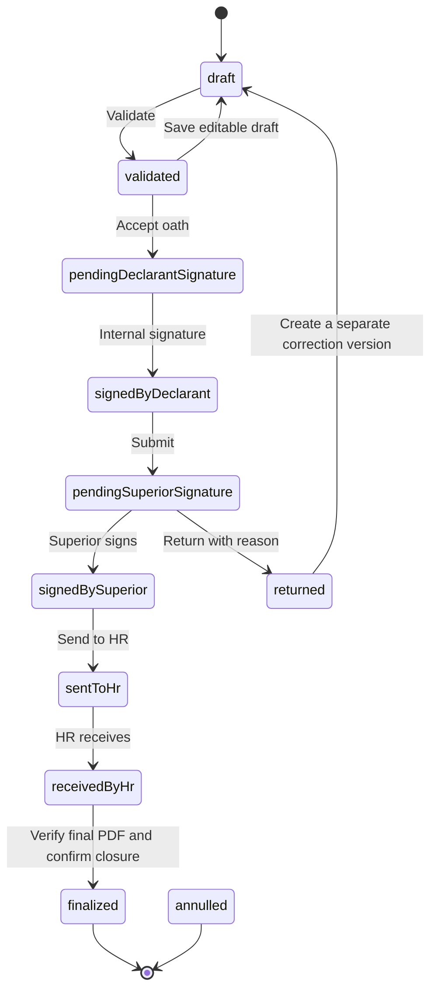

# User manual

Current local application, reviewed November 10, 2026. UI labels remain in Spanish to match the screen. Start the four terminals using the [README](../README.md#local-startup-four-terminals).

## State and signature workflow

Authorized annulment closes a non-finalized, non-annulled declaration while retaining history. The correction arrow creates a new document; it does not reopen or overwrite the returned version.

## Sign in and profile

Use the local account supplied for your role. There is no public registration or universal password. Password recovery exists; real email delivery is not certified by this local demo. Light/dark theme also applies to login.

The declarant form loads profile data. **Guardar estos datos en mi perfil** saves edits for future declarations.

## Declarant

Create a declaration in an active period whose dates include today. There is one declaration chain per person/period. The current creation flow selects the first eligible period rather than displaying a selector.

Enter institutional appointments, external jobs and optional observations. Save incomplete work as a draft. **Validar declaración** requires valid profile/schedule data. Read and explicitly accept the available oath, sign internally and submit to the assigned supervisor. Status and audit history show progress.

A returned declaration includes a reason and a correction action that creates a new version. Previous signed content/evidence remain available.

### Appointments and teaching workloads

New institutional appointments use a category selector: **Interino** or **En propiedad**. Legacy categories remain readable; editing requires explicitly choosing a supported option. External job titles remain free text.

The optional **Sigla del curso** accepts up to 40 characters. It appears in summaries, schedules, review screens and PDFs. Previous appointments without it remain valid.

Type `0800` to obtain `08:00`; type `20261028` to obtain `2026-10-28`. Separators are inserted automatically. Pasting formatted values is supported; real date/time validation still applies.

Choose a workload and classify blocks as **Clase** or **Consulta**:

| Workload | Weekly total | Teaching | Consultation |
| --- | --- | --- | --- |
| Full time | 40 h | 26 h 40 min | 13 h 20 min |
| Half time | 20 h | 13 h 20 min | 6 h 40 min |
| Quarter time | 10 h | 6 h 40 min | 3 h 20 min |

Consultation accounts for 30 minutes per teaching hour and is included in the total. The dialog shows entered/required minutes and the consultation limit supported by entered teaching time. Drafts may be incomplete; validation and signatures require the exact distribution.

Legacy appointments retain custom workloads unless explicitly adapted while editing. Signed versions are not migrated. External jobs retain custom workloads without this split.

### Weekly preview and validation

The weekly schedule below **Otras instituciones** updates when appointments are applied, edited or removed. It includes external work, validity dates and activity labels. Drag the horizontal/vertical scrollbars to see all blocks.

Validation checks Monday–Saturday blocks, start/end order, weekly workload, overlaps with intersecting validity dates, the excluded lunch interval 12:00–13:00 and a combined maximum of 10 hours per day. Consultation and external jobs participate in these checks.

### Approved schedule downloads

Open **Mi horario aprobado** and select a period. It shows institutional appointments, teaching/consultation, course codes and validity dates, with horizontal/vertical scrolling. External jobs are not included.

Only the latest formal version per period is considered. It needs superior signature evidence and a state of signed by superior, sent to HR, received by HR or finalized. A newer pending, returned or annulled version prevents an older approval from appearing as current.

**Descargar PDF** creates a paginated visual copy. **Descargar PNG** includes the whole schedule; use PDF if the image would exceed 16000 pixels in height. Downloads re-read authorized server data and require connectivity. These are visual schedule copies, distinct from the final declaration PDF.

## Supervisor

Review the assigned inbox. Sign or return with a mandatory observation. Send signed declarations to HR. Assignments govern pending access; historical signatures remain linked to the actual signer even if the assignment changes.

## Human Resources

Receive the declaration sent by the supervisor, inspect it, generate/download its final PDF and finalize it. Finalization requires the stored PDF and consistent evidence. Supervisor assignments are available according to role permissions.

## Administrator

### Academic periods

The panel initially shows **Activos**. Switch to **Inactivos** for disabled periods. **Buscar por identificador** filters immediately by any part of the ID, ignoring letter case; Enter is unnecessary. Clearing the search preserves the state filter.

The list has a maximum height of 360 pixels and its own scrollbar. Create/edit actions retain filters. The active filter reflects the configured flag, not date validity. Disabling a period does not delete it.

### Roles and assignments

Assign roles to existing profiles by UID. Self role changes are rejected. Supervisor assignment is separate and requires active profiles with suitable roles. The first administrator requires trusted provisioning.

### Annulment

1. In **Anular declaración**, click **Consultar declaraciones**.
2. Choose a period, including an inactive one if needed.
3. Search by name, UID or declaration ID within loaded results. **Cargar más** loads the next page of 50.
4. Select an eligible declaration. Finalized and annulled rows are locked.
5. ID, formal version and concurrency revision are filled automatically as read-only values.
6. Enter a reason, click **Anular**, review the identity/period/reason and confirm the intended record.

Annulment is irreversible for that document and preserves history. Return for correction is different: it allows a new version. If the declaration changed after selection, the server rejects the stale request; consult it again. Selection alone does not annul anything.

## Troubleshooting and shutdown

Missing periods require an active flag and valid dates. Missing oath text requires the approved registry, not manual state edits. Keep the emulator define in the Flutter command. Do not include real credentials/private data in screenshots.

Follow [safe shutdown](../README.md#safe-shutdown-and-backups): stop the backup monitor, run the final backup while emulators remain running, wait for `Backup complete`, then close services.
